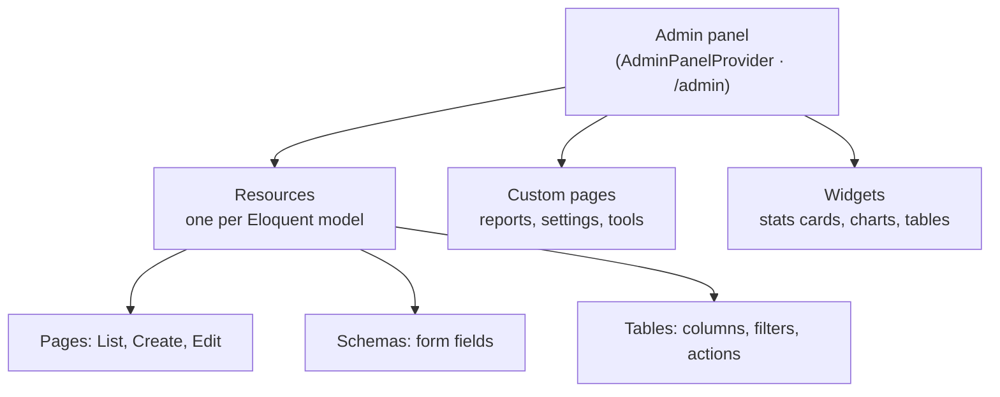

# Why Filament Is the Best Admin Framework for Laravel

*By [Lucky Ram](https://about.me/luckyram) · Laravel & Filament Developer*

Filament lets a Laravel developer ship a polished admin panel in hours instead of weeks, using plain PHP instead of a separate JavaScript frontend.

---

## What is Filament?

Filament is a free, open-source set of full-stack components for Laravel, built on the TALL stack: **Tailwind CSS, Alpine.js, Laravel and Livewire**. You describe forms, tables and dashboards in PHP classes, and Filament renders a responsive UI for you.

It suits admin dashboards, CRMs, inventory systems, internal tools and SaaS back offices. If you know Eloquent, you already know most of what Filament needs.

---

## Why Filament is the best choice

1. **Write PHP, get a full UI** — no React or Vue build to maintain
2. **Fast delivery** — one command generates list, create and edit pages for a model
3. **Rich form fields** — selects with search, date pickers, file uploads, rich editor, repeaters, tabs, wizards
4. **Powerful tables** — sorting, search, filters, bulk actions and pagination in a few lines
5. **Dashboards** — stats cards and charts out of the box
6. **Auth and multiple panels** — login, password reset, profile, and separate panels like `/admin` and `/app`
7. **Multi-tenancy** — team or company data separation for SaaS
8. **Free and open source** — MIT licensed, with a large plugin ecosystem
9. **Themeable** — Tailwind-based, with dark mode and custom branding

| Option | Language | Cost | Best for |
| --- | --- | --- | --- |
| **Filament** | PHP (Livewire) | Free | Fast, flexible admin panels and SaaS back offices |
| Laravel Nova | PHP + Vue | Paid | Teams already using Laravel's paid tools |
| Backpack | PHP + Blade | Free core, paid add-ons | Classic CRUD admins |
| Custom React / Vue | JavaScript | Free, slow to build | Highly custom frontends |

---

## How Filament is structured

Everything lives inside a **panel**. A panel is made of **resources**, **custom pages** and **widgets**, all built from the same form and table builders.



Folder layout after generating a resource:

```text
app/
├── Filament/
│   ├── Resources/
│   │   └── Medicines/
│   │       ├── MedicineResource.php      # model, navigation, pages
│   │       ├── Pages/                    # List, Create, Edit
│   │       ├── Schemas/MedicineForm.php  # form fields
│   │       └── Tables/MedicinesTable.php # columns, filters, actions
│   ├── Pages/                            # custom pages
│   └── Widgets/                          # dashboard widgets
└── Providers/Filament/AdminPanelProvider.php
```

---

## Installation (Filament 5)

**Requirements:** PHP 8.2+, Laravel 11.28+, Composer 2

### Step 1 — Create a Laravel project

```bash
composer create-project laravel/laravel filament-demo
cd filament-demo
php artisan migrate
```

### Step 2 — Install Filament

```bash
composer require filament/filament:"^5.0"
php artisan filament:install --panels
```

On Windows PowerShell use `"~5.0"`. Press Enter to keep the panel ID `admin`.

### Step 3 — Create an admin user

```bash
php artisan make:filament-user
```

### Step 4 — Run it

```bash
php artisan serve
```

Open `http://127.0.0.1:8000/admin` and log in. If the panel doesn't load, check that `AdminPanelProvider` is listed in `bootstrap/providers.php`.

---

## Your first resource

```bash
php artisan make:model Medicine -m
php artisan make:filament-resource Medicine
```

**Form** — `Schemas/MedicineForm.php`

```php
public static function configure(Schema $schema): Schema
{
    return $schema->components([
        TextInput::make('name')->required(),
        TextInput::make('sku')->label('SKU')->required()->unique(ignoreRecord: true),
        TextInput::make('price')->numeric()->prefix('₹')->required(),
        TextInput::make('stock')->numeric()->minValue(0)->default(0),
        DatePicker::make('expiry_date')->required(),
    ]);
}
```

**Table** — `Tables/MedicinesTable.php`

```php
public static function configure(Table $table): Table
{
    return $table
        ->columns([
            TextColumn::make('name')->searchable()->sortable(),
            TextColumn::make('price')->money('INR')->sortable(),
            TextColumn::make('stock')->badge()
                ->color(fn (int $state) => $state < 10 ? 'danger' : 'success'),
            TextColumn::make('expiry_date')->date()->sortable(),
        ])
        ->filters([
            Filter::make('low_stock')
                ->query(fn (Builder $q) => $q->where('stock', '<', 10)),
        ])
        ->recordActions([EditAction::make()]);
}
```

Refresh `/admin` and a **Medicines** menu appears with search, sorting, badges and filters working.

---

## See it in a real project

**[pharmacy-inventory-filament](https://github.com/contact-luckyram/pharmacy-inventory-filament)** — a full pharmacy inventory and billing panel built with Filament 5 ([live demo](https://medistock-xiyz.onrender.com/admin)).

## References

- [Filament installation](https://filamentphp.com/docs/5.x/introduction/installation)
- [Filament resources](https://filamentphp.com/docs/5.x/resources/overview)
